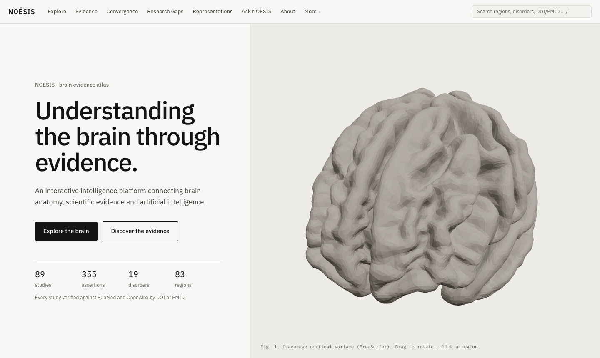

# NOĒSIS

**An AI atlas of brain, behavior & evidence.**

**Live demo: [noesis-hazel.vercel.app](https://noesis-hazel.vercel.app)**

[](https://noesis-hazel.vercel.app)

The public demo runs without an AI key: the assistant shows the evidence it
retrieves as source cards, without AI synthesis.

NOĒSIS connects a real 3D human brain atlas to a DOI/PMID-verified evidence
corpus, convergence and evidence-gap analytics, evidence-derived ML
representations, and a citation-validated AI research assistant.

- **Explore:** an interactive fsaverage/Desikan-Killiany brain (68 cortical
  regions + 15 subcortical structures) with evidence-density, cross-modal
  convergence, evidence-structure (gaps/conflicts), and disorder-comparison
  overlays; every legend states its metric's definition.
- **Evidence:** 89 curated studies / 355 assertions across 19 psychiatric
  and neurodegenerative disorders; every association is traceable
  region → assertion → study → DOI/PMID, and every study's metadata is
  verified against PubMed and OpenAlex before ingestion.
- **Converge & discover:** rule-based convergence profiles, conflict
  surfacing (never auto-adjudicated), documented gap-detection rules, and
  AI-generated research questions grounded in those gaps with full
  provenance chains.
- **Represent:** interpretable PCA/UMAP embeddings of regions, disorders
  and studies computed from the evidence corpus, explorable in 2D and
  bridged both ways with the 3D atlas.
- **Ask:** a RAG assistant that answers only from retrieved evidence, cites
  every claim, and drives the 3D visualization from natural language.

The site opens on a scroll-driven introduction built from the live
corpus; the research application lives behind the main navigation
(Explore · Evidence · Convergence · Research Gaps · Representations ·
Ask NOĒSIS · About).

**Not a diagnostic tool.** Associations shown do not establish causation.
Research findings are group-level averages that often cannot describe an
individual's experience — anything personal belongs with a licensed
clinician.

## Quickstart

```bash
npm install
npm run dev            # http://localhost:3000
```

The AI assistant and research-question generation need an Anthropic API key:
copy `.env.example` to `.env.local` and set `ANTHROPIC_API_KEY`. Everything
else works without it, and without a key the assistant still returns the
matching indexed records as labelled source cards (no synthesis).

## Scripts

| Command | Purpose |
|---|---|
| `npm run dev` / `build` / `start` | Next.js app |
| `npm run validate:data` | Zod schemas + referential integrity + artifact checks (CI gate) |
| `npm test` | unit tests (vitest) |
| `npm run check:ai` | live check of the AI layer with your key (a few cents): intent, retrieval, synthesis, citation validation, one research question |
| `npm run e2e` | 49-check Playwright suite incl. phone-width layouts (self-contained server) |
| `npm run report:gaps` | convergence profiles + detected evidence gaps |
| `npm run lint` | ESLint incl. Next 16 hooks rules |

### Offline pipeline (conda env `noesis`, `pipeline/requirements.txt`)

The PubMed abstract cache is not in the repository (abstracts may be
publisher-copyrighted); rebuild it before re-curating with
`python pipeline/curation/fetch_pubmed.py fetch $(jq -r '.[].pmid // empty' data/studies/studies.json)`.

Meshes: `pipeline/meshes/` (fsaverage → GLB + region sidecars). Evidence:
`pipeline/curation/` (PubMed cache → curated judgments → build →
**verification gate**). Representations:
`pipeline/embeddings/build_representation.py`. Human review:
`pipeline/curation/mark_verified.py --show-next`. Meta-maps / morphometry
maps / ML runs: `pipeline/metamaps/`, `pipeline/encoders/`,
`pipeline/mlruns/` (see `docs/METRICS.md` for every displayed definition).

## Deploying a demo

The web app has **zero Python runtime dependencies** — every model result
is a static, schema-validated artifact in `public/`. It deploys to Vercel
as-is:

```bash
npx vercel login          # once, with your account
npx vercel --prod         # from the repo root
```

In the Vercel project settings, add `ANTHROPIC_API_KEY` (server-side
only; never prefix it with `NEXT_PUBLIC_`). Add `NEXT_PUBLIC_GITHUB_URL`
only once the repository is public — the site hides the GitHub link
while it is unset.

(`npx vercel deploy --temporary` gives an account-less preview URL that
expires within the hour unless claimed.) The assistant degrades gracefully
without `ANTHROPIC_API_KEY`; set it in the Vercel project env to enable
live answers.

## Documentation

| Doc | Content |
|---|---|
| `docs/NOESIS_ARCHITECTURE.md` | as-built architecture |
| `docs/NOESIS_SCIENTIFIC_RULES.md` | non-negotiable integrity rules (no fabricated science, AI-as-interpretation-layer, hedged language, metric transparency) |
| `docs/METRICS.md` | exact definition of every displayed metric |
| `docs/NOESIS_ROADMAP.md` | status, priorities, technical debt |
| `docs/NOESIS_DATA_SOURCES.md` / `data/LICENSES.md` | provenance & licensing |
| `docs/NOESIS_DECISIONS.md` | decision log |
| `docs/ARCHITECTURE.md` | the founding blueprint |

Project subagents for Claude Code live in `.claude/agents/`.
